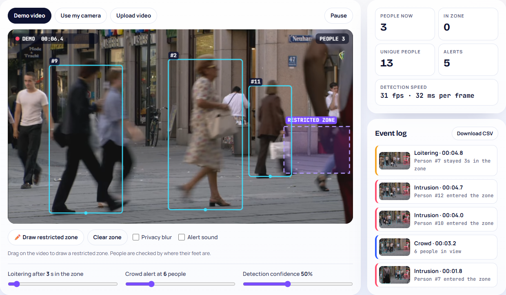
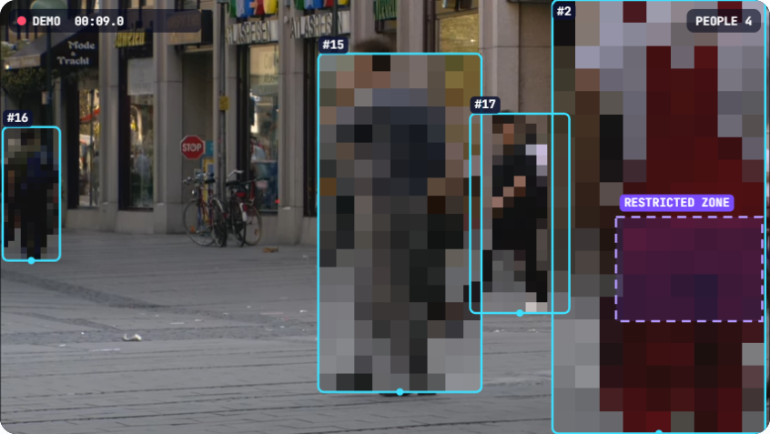

# Smart CCTV Safety Monitor 🎥

A privacy-first smart CCTV prototype that runs **entirely in the browser**. It detects people, follows each one with an ID, and raises alerts when someone **enters a restricted zone**, **loiters** there, or a **crowd** forms. The video never leaves the device.

**🔗 Live demo:** https://smart-cctv-safety-monitor.vercel.app
**👤 Portfolio:** https://priyanshu-zihowa.vercel.app



---

## Features

| | |
|---|---|
| **3 video sources** | built-in demo video, your webcam, or an uploaded video file |
| **Person detection** | EfficientDet-Lite0 (Google MediaPipe), about 30 fps in the browser |
| **Multi-person tracking** | every person keeps one ID while they move (my own tracker, see below) |
| **Restricted zone** | drag on the video to draw it; checked by each person's foot position |
| **Alerts** | 🚫 intrusion · ⏱️ loitering (adjustable time) · 👥 crowd (adjustable limit) |
| **Event log** | time, alert type and a snapshot; download it as CSV |
| **Privacy blur** | pixelates every detected person, so the system can count and alert without showing faces |



---

## How it works

```
video frame ─▶ detector (people + confidence) ─▶ tracker (IDs) ─▶ rules (zone, time, count) ─▶ alerts + drawing
```

### 1. Detect
A pretrained **EfficientDet-Lite0** object detector (MediaPipe Tasks, WebGL/WASM) returns a box and a confidence score for every person in the frame. Only the "person" class is used.

### 2. Track: written from scratch ([`web/js/tracker.js`](web/js/tracker.js))
A detector only says *where people are in this frame*. To raise an alert like "this person has been in the zone for 3 seconds", you must know **which** person is which across frames. The tracker:

* **predicts** where each person will be using their recent speed (constant-velocity model, as in SORT),
* **matches** predictions to new boxes by **IoU** (overlap), with a centre-distance fallback for fast movement,
* uses **two-stage matching, the core idea of ByteTrack (2022)**: confident detections are matched first and may start new tracks; low-confidence detections (a person partly hidden behind someone) are used only to *keep existing tracks alive*,
* **removes duplicate boxes** the detector sometimes returns for one person,
* only **confirms** a track after 3 hits, which filters out one-frame false detections.

### 3. Rules
* **Foot point:** a person is "in the zone" when the bottom-centre of their box is inside the zone polygon (ray-casting point-in-polygon test). This matches where someone is actually standing.
* **Intrusion** fires once per entry. **Loitering** fires once a person has stayed in the zone for the set time. **Crowd** fires when the number of people reaches the limit, with a cooldown.
* **Hysteresis:** someone standing on the zone edge jitters in and out every frame. A person only counts as having left after 1 second outside, so the edge can't spam alerts.

---

## Results and testing

**Unit tests:** 15 tests for the geometry, tracker and rules (`npm test`, Node's built-in test runner), including fast movement, short occlusions, duplicate boxes, edge jitter and re-entry.

**Measured on the demo video** (14-second runs in Chrome, laptop GPU):

| | People tracked per frame | Track IDs created |
|---|---|---|
| One-stage matching (confident detections only) | 2.0 | 25 |
| **Two-stage matching (ByteTrack idea)** | **3.4** | **21–26** |

Two-stage matching keeps **~70% more people tracked** at the same time without creating more IDs. Detection runs at **~31 fps (~32 ms per frame)**.

---

## What I learned

* **Tests catch real bugs.** My first tracker gave a fast-walking person a new ID every few frames; a unit test exposed it, and velocity prediction fixed it.
* **Measure, don't guess.** Lowering the confidence threshold detected more people but also created more false IDs. Measuring both numbers led to the two-stage approach instead.
* **Real-world edge cases matter.** Without hysteresis, one person standing on the zone edge produced a stream of alerts.
* **Know the limits.** When a person walks right in front of another, the tracker can swap their IDs ("track hijacking"). Production systems add appearance features (DeepSORT) to fix this.

## Limitations
* A small, fast detector: far-away or heavily blurred people are sometimes missed.
* ID switches can still happen during long occlusions.
* A prototype for learning, **not a certified security product**. Real deployments also need consent, signage and local privacy-law compliance.

---

## Project structure

```
smart-cctv-safety-monitor/
├── web/
│   ├── index.html
│   ├── style.css
│   ├── js/
│   │   ├── app.js       # video sources, detection loop, drawing, zone editor, event log
│   │   └── tracker.js   # IoU tracker, two-stage matching, dedupe, zone rules (no browser code)
│   ├── models/          # efficientdet_lite0.tflite
│   └── media/           # demo video (CC0)
├── tests/
│   └── tracker.test.mjs # 15 unit tests
└── docs/                # screenshots
```

## Run it yourself

```bash
npm test
```

```bash
python -m http.server 5502 --directory web
```

Then open http://localhost:5502. (The camera needs `localhost` or HTTPS.)

---

## Tech
JavaScript (ES modules) · MediaPipe Tasks Vision · EfficientDet-Lite0 · Canvas 2D · Node test runner · Vercel

## Credits
* Demo video: "Video Codec Test pedestrian area 1080p25", Taurus Media Technik, **CC0**, via [Wikimedia Commons](https://commons.wikimedia.org/wiki/File:Video_Codec_Test_pedestrian_area_1080p25.y4m.webm).
* Detection model: EfficientDet-Lite0 via [Google MediaPipe](https://ai.google.dev/edge/mediapipe/solutions/vision/object_detector) (Apache 2.0).
* Tracking ideas: SORT (Bewley et al., 2016) and ByteTrack (Zhang et al., 2022).
* Built by **Priyanshu Zihowa**, with Claude Code as a coding assistant.

## License
MIT
